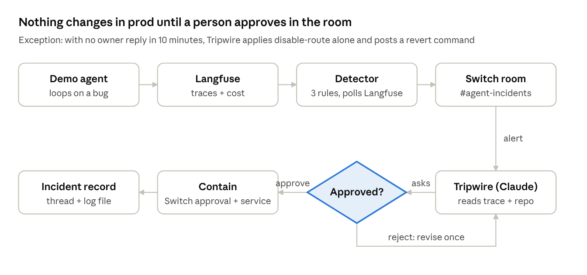

# switch-hack

Tripwire: a Switch room agent that watches Langfuse traces for runaway AI-agent behavior and contains it after an owner approves in Slack. Built for the WeMakeDevs "Flip the Switch" hackathon.

- [Product proposal](tripwire-product-proposal.md): problem, design, flow charts, decisions, test plan.
- Flow charts: [`images/`](images/)
- Status and what was verified: [docs/verification.md](docs/verification.md)
- **Set up in Switch:** [docs/switch-setup.md](docs/switch-setup.md) is the click-by-click guide for your own Switch Console and Slack on a laptop.



## What Tripwire does

A demo order-lookup agent sends its traces to a self-hosted Langfuse. Tripwire reads those traces and looks for three failure shapes:

- **loop**: the same tool call repeats in one trace;
- **silent_error**: a route keeps returning errors or "not found" without raising;
- **cost_spike**: one trace or route spends far above its normal median.

When a rule fires, Tripwire opens an incident and posts an alert in the Switch room. An owner approves one containment action in the room: `disable_route`, `cap_max_steps` or `fallback_model`. A budget-limited auto-pause can disable a route without an owner. Tripwire then verifies that the loop has stopped, resolves the incident, and writes an incident record. A fix PR can be opened for the proposed patch. The agent never merges it.

## Architecture

| Part | Path | Role |
| --- | --- | --- |
| Containment service | `tripwire/containment/` | FastAPI on `:8700`. The only writer of incident state (`incidents.json`) and flags (`flags.json`). Enforces the action menu, the one-action-per-ask-round rule and the state transitions. |
| Detector | `tripwire/detector/`, `tripwire/rules/` | Polls Langfuse every `poll_seconds`, keeps a 60-minute trace window, runs the three rules, opens incidents, auto-pauses, verifies and records. |
| Langfuse reader | `tripwire/langfuse_client.py` | Synchronous HTTP client with timeouts and bounded 5xx retries. |
| Switch client | `tripwire/switch_client.py` | Posts alerts and replies to the Switch room (agent path), or to Slack (fallback path). Compose and `.env.example` set dry run (`SWITCH_DRY_RUN=1`), which logs instead of posting. |
| Incident records | `tripwire/records.py` | Renders each incident record and appends it to a JSONL log. |
| Tripwire agent | `tripwire_agent/` | Room template, instructions, and an MCP tool server. The server runs the budget guard (20 calls, 3 minutes per ask round) and the fix-PR tool. |
| Demo agent | `demo_agent/` | The order-lookup victim agent, with switchable `loop`, `silent_error` and `cost_spike` bugs. Runs offline or online. |
| Paid evals | `tests/eval/`, `scripts/run_evals.sh` | Real-model evals of the Tripwire agent. Skipped without `ANTHROPIC_API_KEY`. |

Incident state lives only in the containment service. The detector and the tool server read and change it through HTTP.

## Quickstart

Needs Python 3.11+, [uv](https://docs.astral.sh/uv/), Docker with Compose, and `openssl`.

```bash
uv sync
uv run pytest -q
cp .env.example .env
scripts/bootstrap_langfuse.sh   # fills the CHANGEME secrets and Langfuse keys in .env
docker compose up -d            # Langfuse, containment, detector
docker compose run --rm demo-agent   # one run of the demo agent (set DEMO_BUG in .env)
```

Open Langfuse at http://127.0.0.1:3000 and the containment service at http://127.0.0.1:8700/flags. Both are bound to 127.0.0.1.

Run the pieces outside Compose:

```bash
# containment service (single worker: its write lock is per process)
TRIPWIRE_CONFIG=tripwire.yaml TRIPWIRE_STATE_DIR=./containment-state \
  uv run uvicorn --factory tripwire.containment.app:create_default_app --host 127.0.0.1 --port 8700 --workers 1

# detector
uv run python -m tripwire.detector --config tripwire.yaml

# demo agent, scripted model, no key and no Langfuse needed
uv run python -m demo_agent run --bug loop --n 1 --offline

# tool server for the Tripwire agent (MCP over stdio; register it in the agent's Claude Code config)
LANGFUSE_HOST=http://localhost:3000 TRIPWIRE_CONFIG=tripwire.yaml uv run python -m tripwire_agent.server
```

## Tests

```bash
uv run pytest -q                 # offline suite; the paid evals skip without a key
uv run pytest -q -m 'not eval'   # same, explicitly without the paid set
uv run pytest -q -m eval -rs     # paid evals only (needs ANTHROPIC_API_KEY and the claude CLI)
```

The offline suite makes no network calls. Unit tests use the fakes in `tests/fakes/`, and HTTP is mocked with `httpx.MockTransport`.

### Paid evals

These run real model calls and cost money. They are not run in CI.

```bash
export ANTHROPIC_API_KEY=...
scripts/run_evals.sh --runs 5    # writes docs/eval-results.md: case, runs, passes, cost
```

Pass counts are pending. See [docs/verification.md](docs/verification.md#pending-how-to-finish).

## Configuration

`tripwire.yaml` holds the rules, routes, auto-pause and owners. Secrets are env-var names only. Values come from the environment.

| Setting | Default | Meaning |
| --- | --- | --- |
| `poll_seconds` | 15 | Detector poll interval |
| `window_minutes` | 60 | Rolling trace window every rule judges |
| `containment_url` | `http://127.0.0.1:8700` | Containment service |
| `langfuse_host` | `http://localhost:3000` | Langfuse; `LANGFUSE_HOST` overrides it |
| `records_path` | `incident-records.md` | Incident record log; `--records` overrides it |
| `rules.loop` | `max_repeats 5`, `max_observations 25` | Repeat rule; `max_observations` is the only catch for reworded loops |
| `rules.silent_error` | `count 3`, `window_minutes 5`, `patterns ["error","not found"]` | Silent-error rule |
| `rules.cost_spike` | `median_multiplier 5`, `per_trace_usd 1.0` | Cost-spike rule |
| `allow_list_tools` | `[list_orders_page]` | Tools the loop rule ignores |
| `routes.<name>` | `loss_budget_usd`, `hourly_ceiling_usd` | Per-route budgets (`order-lookup`: $50 and $50) |
| `auto_pause` | `minutes 10`, `budget_fraction 0.5` | When the detector may pause a route alone |
| `verify_minutes` | 5 | Quiet time before an incident resolves |
| `tripwire_guard` | `max_tool_calls 20`, `max_minutes 3` | Tool-server budget per ask round |
| `fix_pr` | empty | Local clone, GitHub owner and repo for fix PRs; empty turns the tool off |
| `owners` | `[jason]` | Who may approve or revert |
| `room` | `agent-incidents` | Switch room name |

Environment variables:

| Variable | Used by | Notes |
| --- | --- | --- |
| `LANGFUSE_PUBLIC_KEY`, `LANGFUSE_SECRET_KEY` | detector, tool server, demo agent | Project keys. `bootstrap_langfuse.sh` writes them. |
| `LANGFUSE_HOST` | detector, tool server, demo agent | Overrides `langfuse_host`. Compose sets `http://langfuse-web:3000`. |
| `TRIPWIRE_CONFIG` | containment, tool server | Path to `tripwire.yaml` (default `tripwire.yaml`) |
| `TRIPWIRE_STATE_DIR` | containment | State directory (default `containment-state`; Compose uses `/state`) |
| `TRIPWIRE_CONTAINMENT_URL` | demo agent | Containment URL for the demo agent (Compose sets it) |
| `SWITCH_DRY_RUN` | detector | `1` logs instead of posting. Keep `1` until Switch is set up. |
| `SWITCH_PATH` | detector | `agent` (default) or `slack` |
| `SWITCH_BASE_URL`, `SWITCH_AGENT_ID`, `SWITCH_ROOM_ID`, `SWITCH_TOKEN` | detector, agent path | `SWITCH_TOKEN` is the agent key (`SWITCH_AGENT_KEY` is also read) |
| `SWITCH_STATUS_MODE` | detector | `reply` (default) or `edit` |
| `SLACK_BOT_TOKEN`, `SLACK_CHANNEL` | detector, slack path | Slack fallback |
| `GITHUB_TOKEN` | tool server (fix PR) | Pull requests and contents write on the repo in `fix_pr` |
| `ANTHROPIC_API_KEY`, `ANTHROPIC_MODEL` | demo agent (online), evals | Real model calls |
| `DEMO_BUG`, `DEMO_RUNS` | Compose demo agent | Bug to switch on (`none`, `loop`, `silent_error`, `cost_spike`) and run count |

Keep secrets in `.env` (git-ignored) or the environment. Never commit them.

## Status

- Offline suite: 348 passing, 5 paid evals skipped (no key).
- Live: the Compose stack came up with Langfuse v3, and the detector polled Langfuse 35 times with HTTP 200.
- Pending: the paid evals (T13, T16, T19), a live loop incident, and the Switch room tests (T14, T20). Each needs a key or a live Switch room. Steps are in [docs/verification.md](docs/verification.md).
- Provisional: the Switch client and the agent package are built against [docs/switch-api.md](docs/switch-api.md) and have not been checked against a live room.

Known issues, including a containment bug that can uncap a route when two incidents share it, are listed in [docs/verification.md](docs/verification.md#known-issues).

## Future work

From the proposal's scope table:

- ML-based anomaly detection
- Per-team rooms and PagerDuty escalation
- Auto-generated regression tests
- Real flag services (LaunchDarkly, Unleash)
- Auto-merge of low-risk fixes
- Weekly incident digest

The hackathon build's loop rule catches only repeats of the same call. Reworded loops are caught only by the `max_observations` cap.
