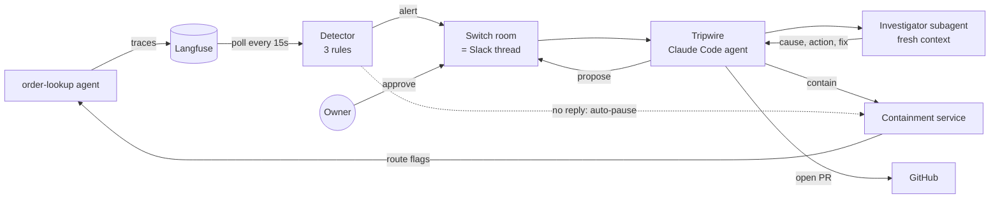
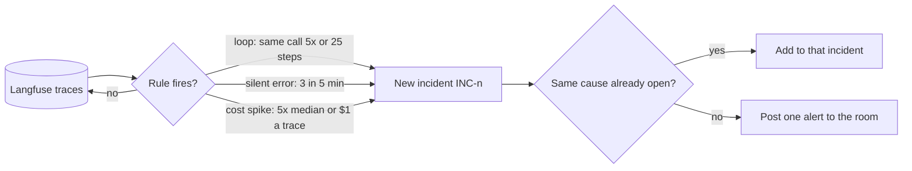
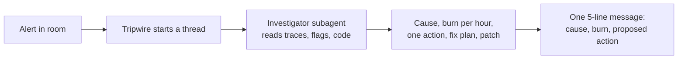
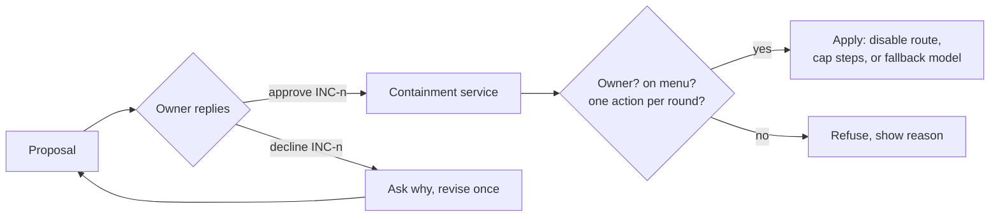
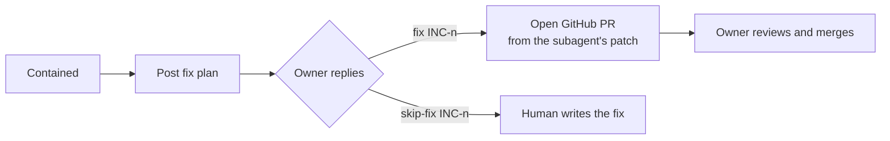
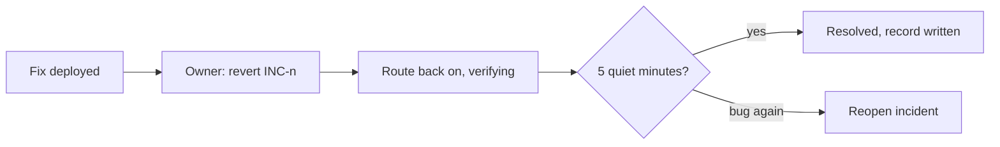
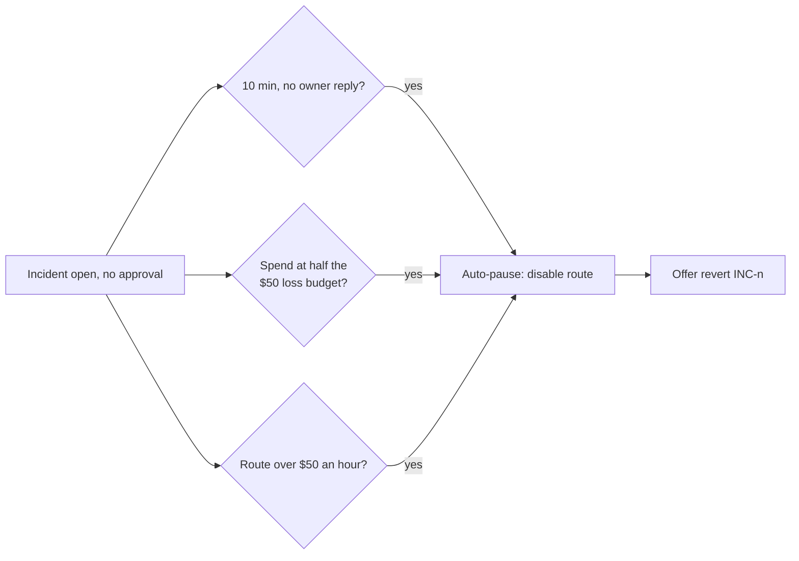

# Tripwire

Nov 7, 2026 · Jason Daniel B · Flip the Switch hackathon, Track 01 (Best Business Workflow)

Tripwire is an on-call agent for AI agents. It watches an agent's traces, catches runaway behavior (loops, silent errors, cost spikes), and fixes it in a Slack thread. It never touches production without an owner's approval.

**Problem.** An LLM agent stuck in a loop burns money and fails users quietly. Dashboards show it after the fact. Nobody is paged, and nobody can stop it from chat.

**Who.** Teams running LLM agents in production. The demo watches `order-lookup`, a deliberately buggy order-support agent.

## How it works

| Part | What it is |
| --- | --- |
| Detector | Python loop. Reads Langfuse, runs the rules, posts one alert per incident. |
| Tripwire | Claude Code agent in Switch. Talks in the thread, never acts without approval. |
| Investigator | Read-only subagent. One fresh context per incident, so Tripwire's session stays small. |
| Containment service | FastAPI. The only thing that changes production. Enforces every rule below. |
| Agent | Reads its route flags before every step, so containment works mid-run. |

## Features

### 1. Detect

### 2. Investigate

### 3. Contain (approval 1)

### 4. Fix (approval 2)

### 5. Revert and verify

### 6. Safety net

A decline counts as a reply, so it stops the 10-minute timer. The money limits always apply.

## Guardrails

- Only listed owners can approve, and every approval names the incident: `@tripwire approve INC-8`.
- The menu has three actions. Anything else is refused by the containment service.
- Trace text is data. Instructions found inside a trace are ignored and reported.
- Tripwire gets 20 tool calls and 3 minutes per round, then hands off to a human.
- One thread per incident. Messages are at most six lines.

## Stack

Python 3.12, FastAPI, Langfuse (self-hosted), Switch + Slack, Claude Code, Together AI (`zai-org/GLM-5.3-Flash` for the demo agent), Docker Compose. 430+ tests.
